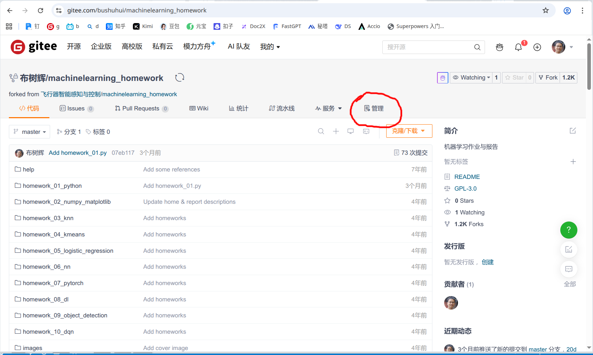
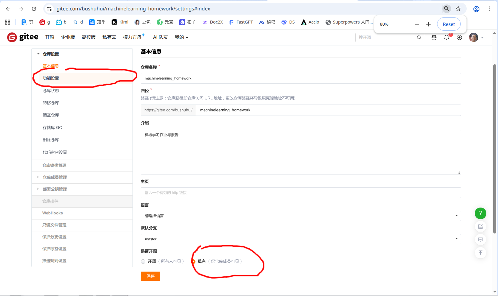
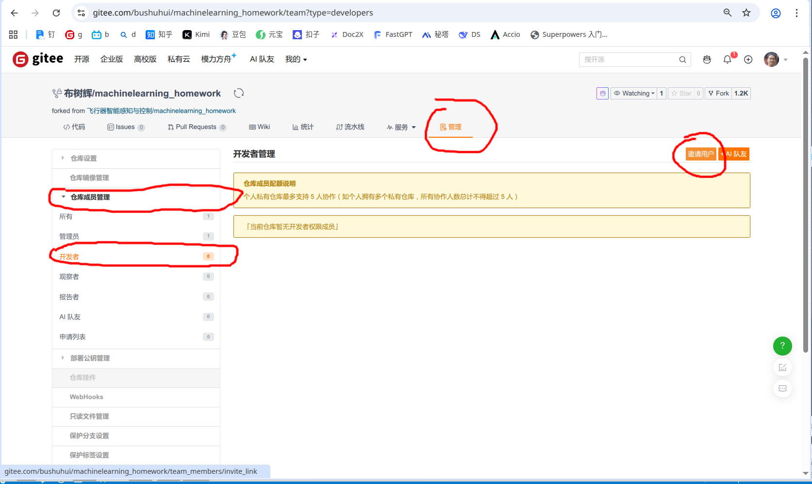
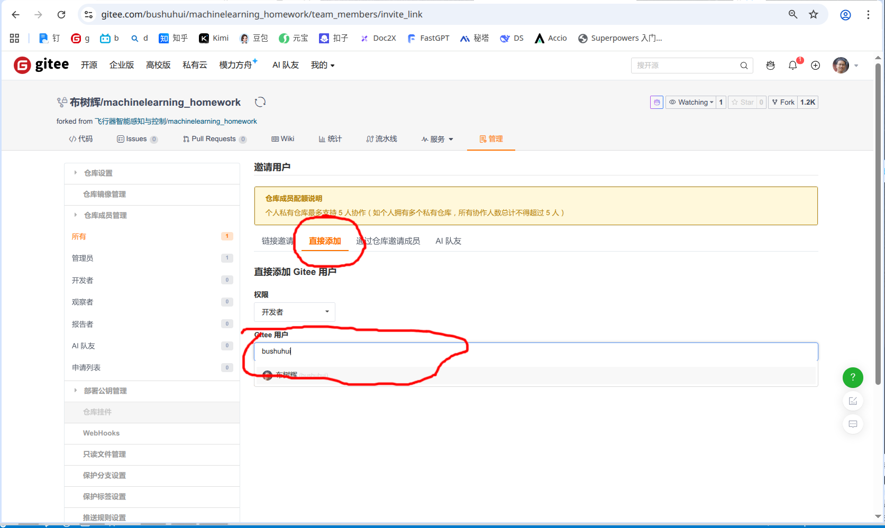

# 课程报告要求

* 报告需要用JupyterNotebook来写，公式，图表完备；也可以写成Python程序+Markdown文档；也可以用Latex来写
* 报告用中文来写；如果感觉自己可以用英语来写，也可以用英语来写
* 需要把每个报告的目的、基础知识、背景、原理、实验、结果、体会等都写清楚
* 从10个报告里面 **选择3个报告** 完成
* 完成后，用PDF打印机将报告打印成PDF文件
  - 将Notebook打印成PDF的时候，需要先检查一下里面的文字、公式、代码、图、表等是否显示正确；如果是Markdown文件，可以使用Markdown编辑器打印成PDF
  - 如果显示不正确，可以先导出成HTML，然后打开HTML文件，再Ctrl-P打印成PDF文件 （Chrome 浏览器）
  - 封皮文件中填入自己的学号、姓名
  - 使用WPS或者其他PDF工具软件（例如：福昕 PDF 编辑器，或者线上工具，自己找一下工具，例如： https://smallpdf.com/cn/merge-pdf ）合并封皮、三个报告到一个PDF文件
* **将合并后的报告文件按照这样的名字命名** ： `<学号>-<姓名>.pdf` (例如： `2011010101-布树辉.pdf`) ， **将合并后的文件放在项目的根目录下** （需要git本地提交，并将本地的修改提交到gitee服务器）
* 不需要提交纸质版的报告，只需要把报告电子版提交到自己的仓库，并更新到gitee服务器上自己的仓库即可
* 大家把自己的作业与报告的gitee地址提交到群里的在线文档
* 请大家认真来完成这个报告，通过这个报告提高自己的研究、学习、写作能力
* 训练数据集，机器学习模型如果文件比较大，不放在这个仓库 （可以使用 [.gitignore](https://zhuanlan.zhihu.com/p/52885189) ），可以将比较大的文件上传到网盘上，把网盘的地址放在报告正文里


## 最后检查

请大家仔细检查一下各自的git仓库
- 打开 https://gitee.com/ 进入到自己的仓库
- 是否上传了报告、报告
- 报告是不是放在仓库的根目录
- 名字是不是 `<学号>-<姓名>.pdf` ， 类似这样的 `2011010101-布树辉.pdf`


## 关于代码

1. 可以挑选关键、重要的部分代码放进报告里
2. 代码可以作为代码块插入到Notebook里，或者Markdown文件里
3. 代码放在仓库里
4. 也可以在文档里写清楚代码在仓库哪里，说明清楚各个部分的功能和作用


## 关于数据、模型文件
* 训练数据集，机器学习模型如果文件比较大，不放在这个仓库 
* 可以使用 [.gitignore](https://zhuanlan.zhihu.com/p/52885189) 将大的文件排除掉
* 可以将比较大的文件上传到网盘上，把网盘的地址放在报告正文里
* 如果不慎提交了比较大的文件，可以从仓库里面删除，参考下面的说明 `如何删除git本地仓库里面比较大的文件`。为保险，先将本地仓库备份一下（例如压缩成一个压缩包，或者复制一份副本）


## 设置作业、报告仓库为私有

如果不想让其他人看到自己的作业和报告，可以设置自己的仓库为私有仓库。但是需要把我（`bushuhui`）加入到你的仓库。以下是具体的操作步骤 ：


1. 进入自己的仓库

2. 点击进入仓库的 `管理`




3. `功能设置` - `是否开源` (私有)




3. `仓库成员管理` - `开发者` - `邀请用户`




4. `邀请用户` - `直接添加` - 输入 `bushuhui`，点击"布树辉"，然后确认添加




## 如何删除git本地仓库里面比较大的文件

### 方法一：仅删除最新提交中的大文件（最简单）

如果大文件只在最近的提交中，且尚未推送到远程：

```bash
# 从暂存区和工作区删除文件
git rm 大文件名.bin

# 提交更改
git commit --amend -m "移除大文件"

# 清理缓存（可选）
git gc --prune=now
```

### 方法二：从历史记录中彻底删除（推荐）

如果大文件已存在于历史提交中，需要使用 `git filter-repo`（推荐）或 `filter-branch`。

#### 使用 git filter-repo（现代推荐方式）

先安装：
```bash
# macOS
brew install git-filter-repo

# Linux
pip install git-filter-repo
```

删除指定大文件：
```bash
# 删除特定文件
git filter-repo --path 大文件名.bin --invert-paths

# 或删除特定目录
git filter-repo --path 目录名/ --invert-paths
```

#### 使用 git filter-branch（旧版方法，较慢）

```bash
git filter-branch --force --index-filter \
'git rm --cached --ignore-unmatch 大文件名.bin' \
--prune-empty --tag-name-filter cat -- --all
```


### 如何找到仓库中的大文件

在清理前，先识别哪些文件占用了空间：

```bash
# 查看仓库中最大的 10 个文件
git rev-list --objects --all | git cat-file --batch-check='%(objecttype) %(objectname) %(objectsize) %(rest)' | awk '/^blob/ {print $3" "$4}' | sort -rn | head -10
```

### 清理后的必要步骤

```bash
# 强制更新远程仓库（如果已推送过历史）
git push origin --force --all

# 清理本地未引用的对象，真正释放磁盘空间
git reflog expire --expire=now --all
git gc --prune=now --aggressive
```

### ⚠️ 重要提醒

1. **重写历史风险**：修改已推送的历史会改变 commit hash，团队协作时需确保其他成员知晓并同步
2. **备份**：操作前建议先 `git clone --mirror` 备份整个仓库
3. **敏感信息**：如果是误传的密码/密钥，仅删除文件不够，需轮换（revoke）相关凭证

如果只是本地暂存区（未提交）的大文件，直接用 `git reset HEAD 文件名` 或 `git checkout -- 文件名` 即可取消跟踪。

