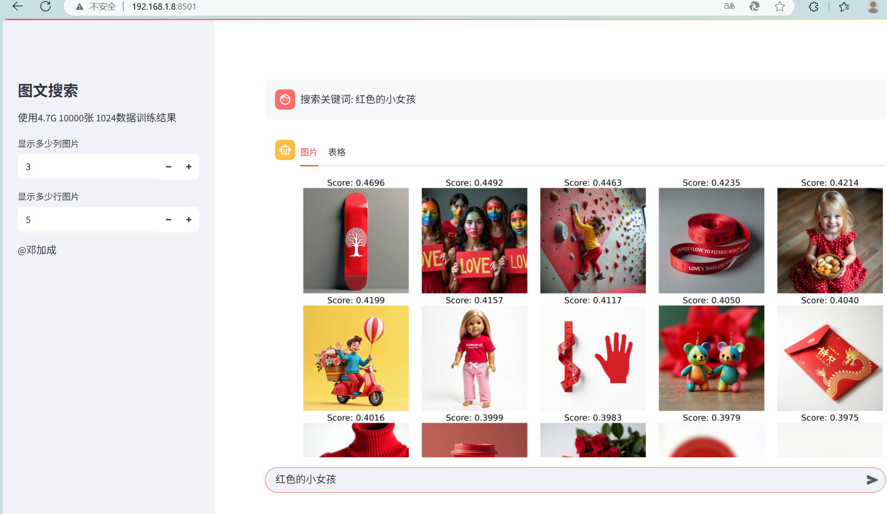

# Report8 - 图像的文字检索

CLIP（Contrastive Language–Image Pre-training）是一种多模态神经网络，它把“图片”和“文字”映射到同一个高维向量空间，使得语义相近的图文对彼此靠近、无关的图文对彼此远离。其最大特点是“零样本”能力：无需针对具体类别再训练，只要给出任意文本提示（如“一只戴帽子的狗”），就能在图像侧直接检索或分类。凭借这一特性，CLIP 已成为跨模态任务的通用基座：在图像搜索里，用户用自然语言就能找到对应图片；在内容审核中，一句描述即可过滤不合规图像；在机器人或自动驾驶场景，CLIP 把视觉感知与人类指令对齐，实现“说啥找啥”的灵活控制。此外，它还被广泛用作图像生成模型（如 Stable Diffusion）的文本编码器，让生成结果精准匹配 prompt。简言之，CLIP 用大规模图文对比学习打通了视觉与语言的壁垒，为“以文搜图、以图生文”的多模态应用提供了即插即用的核心引擎。

本项目通过学习CLIP，LLM翻译，向量数据库，streamlit完成一个文字检索图片的系统，运行的效果如下：

## 数据

数据集可以从这里获取： https://hf-mirror.com/datasets/jackyhate/text-to-image-2M

`text-to-image-2M` 是一个专为微调文生图模型而精心整理的图文对数据集，共包含约 200 万条样本。该数据集经过严格筛选与质量增强，以满足文生图模型训练对数据规模与质量的双重高标准。创建该数据集的初衷源于观察：当数据规模超过 100 万条后，模型的微调效果通常显著提升。然而，目前公开可用的数据集普遍存在规模不足、质量参差或标注噪声大等局限。

## 要求

1. 可以使用脚本 `dl_dataset.sh`下载数据
2. 将数据中的英文通过调用LLM的API自动翻译成中文
3. 学习CLIP的算法、使用。可以使用 https://github.com/OFA-Sys/Chinese-CLIP
4. 测试中文、图像的Embedding
5. 实现模型的中文数据训练
6. 测试基本的检索
7. 开发一个简单 streamlit 界面，能够完成检索词的输入，检索出来图像的显示
8. 分析自己实现的方法的问题，以及如何改进。
9. 深入思考，如何更进一步提高多模态网络的性能？
10. 按照`report_template.md`撰写自己的报告。

## 参考资料

* https://github.com/yuanzhoulvpi2017/zero_nlp/tree/main/chinese_clip_ddp
* https://www.bilibili.com/video/BV1JekBYpEJB
