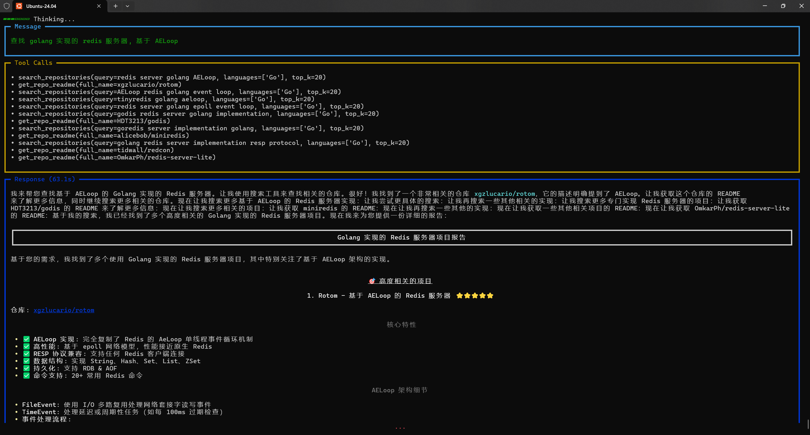

# Report9 - 自动科研论文检索Agent

LLM Agent 是以大语言模型（LLM）为“大脑”的智能体，它把预训练获得的语言与常识能力封装成可行动、可决策的闭环系统：通过提示工程或微调，让模型不仅能“说”，还能“想”与“做”。其典型特点是： 
1. 自主规划——把用户一句话目标自动拆解为可执行步骤； 
2. 工具调用——可插拔地调用搜索引擎、计算器、数据库、API 等外部工具，弥补自身事实与实时性短板； 
3. 记忆机制——利用向量存储、对话历史或摘要，实现长程上下文与个性化记忆； 
4. 反思迭代——通过自我批评、多轮验证或与环境交互，持续修正策略。 

Agent的应用场景已覆盖个人与产业两端：个人助手可自动完成差旅订票、邮件总结、代码调试；企业里，LLM Agent 充当无休息的客服、运维值班、合规审计员；科研端，它能读取文献、生成假设、调用实验脚本并迭代分析，成为“24 小时在线的研究员”。简言之，LLM Agent 把大模型从“问答对话框”升级为“会思考、能动手”的数字员工，正在重塑知识工作的自动化边界。

本项目通过学习LLM基本原理、使用方法，Agent框架、用法，ArXiv等论文库查找等基本知识，完成一个输入需要的主题，Agent自动查找论文并下载到本地磁盘的系统。系统的示意如下图：

## 要求

1. 学习仓库 https://github.com/4everWZ/DailyPaper 里面的代码，学会如何通过Python访问ArXiv等网站
2. 学习仓库 https://github.com/xgzlucario/githubhunt ，掌握Agent的编写
3. 在 githubhunt 基础上，把程序修改、改进成查找输入主题论文的的Agent
4. 按照`report_template.md`撰写自己的报告。

## 参考资料

* https://github.com/xgzlucario/githubhunt 基于 AI Agent 的自然语言 Github 仓库搜索工具
* https://github.com/4everWZ/DailyPaper grab everyday new paper from arxiv
* https://github.com/agno-agi/agno Multi-agent framework, runtime and control plane. Built for speed, privacy, and scale
